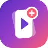
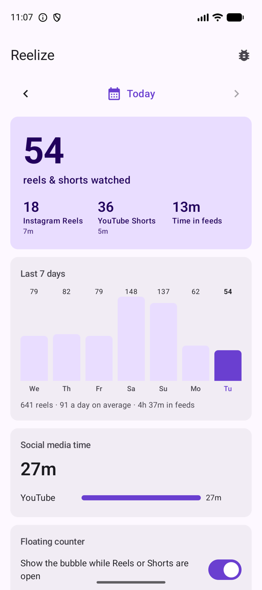
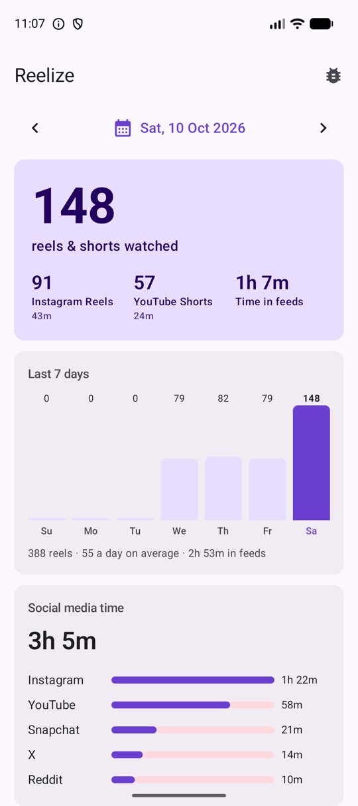
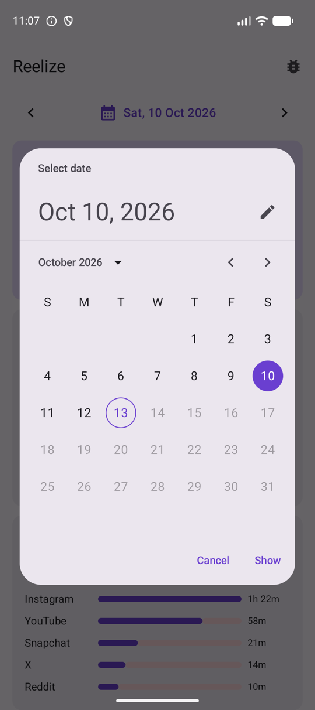
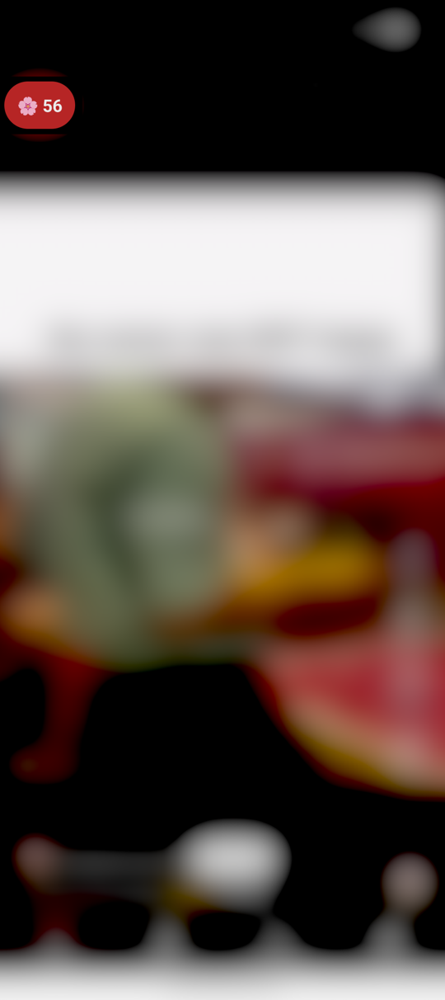
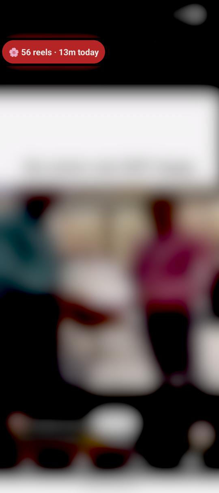
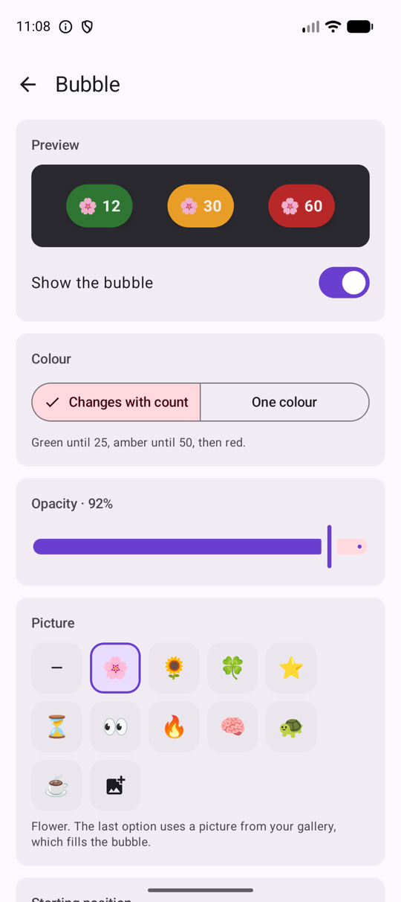
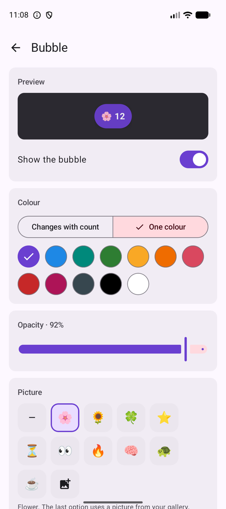
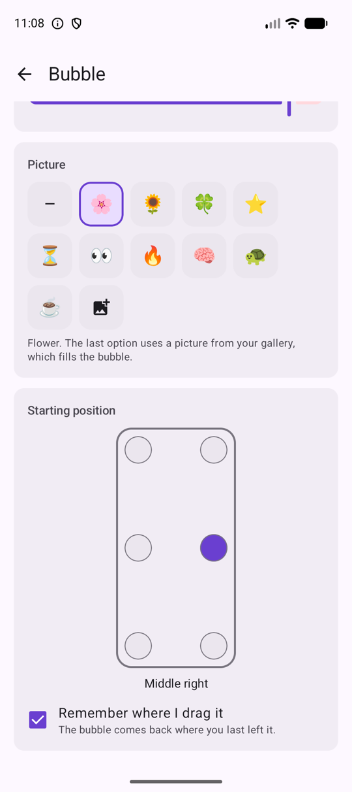
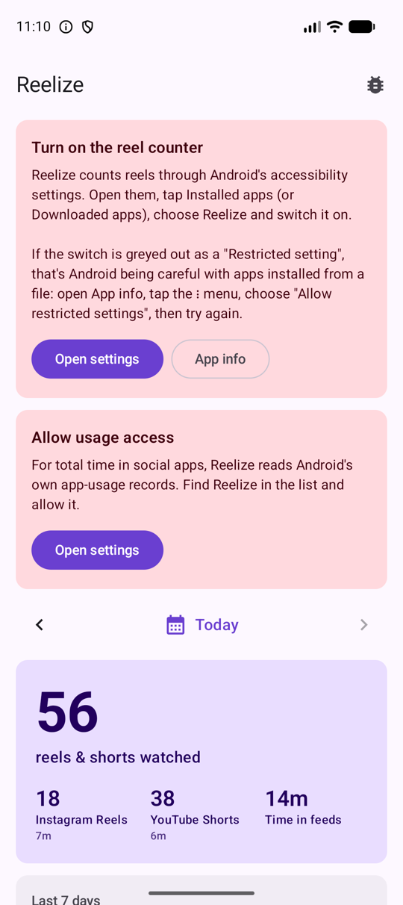

# Reelize

Counts the Instagram Reels and YouTube Shorts you watch. A small floating bubble shows
today's count while you scroll, and the app shows a daily dashboard of reels, time spent in
those feeds, and total time in social apps.

Local only. No account, no cloud, no `INTERNET` permission.

| Today | A past day | Any date |
|---|---|---|
|  |  |  |

| Bubble over Shorts | Tap for today's time |
|---|---|
|  |  |

| Bubble settings | One colour | Picture and position |
|---|---|---|
|  |  |  |

Screenshots are from an emulator with a week of sample data. The video behind the bubble is
blurred.

## Download

**[Latest release](https://github.com/er-shrey/reelize/releases/latest)** - or share this
direct link to the current build:

```
https://github.com/er-shrey/reelize/releases/download/v0.2.0/Reelize-0.2.0.apk
```

Android blocks installs from outside the Play Store until told otherwise, so installing it
takes two one-time steps: allow installs from the app you received the file through, and tap
past the Play Protect "unknown developer" warning.

**"App blocked to protect your device", with only an OK button.** In some countries,
India among them, Play Protect blocks apps that use accessibility from being installed from a
browser, a chat app or a file manager. It has no "Install anyway" option. Installing over USB
from a computer isn't affected:

```
adb install Reelize-0.2.0.apk
```

## Setup

Reelize needs two permissions, both granted in Android settings. The dashboard links to each
one until it is on.

1. **Accessibility: the reel counter.** Settings → Accessibility → Installed apps → Reelize
   → on. On Android 13 and later, an app installed from a file can't switch this on at first
   ("Restricted setting"). Open App info for Reelize, tap ⋮ → **Allow restricted settings**,
   then go back and switch it on.
2. **Usage access: social media time.** Settings → Usage access → Reelize → allow.

| First launch |
|---|
|  |

## Keeping the counter on

If Android force-stops Reelize, it also switches the counter off in Accessibility settings,
and only you can switch it back on. Many phones (Xiaomi, Oppo, Realme, OnePlus, Vivo, Huawei)
force-stop every app in Recents on **Clear all**, and battery cleaners do the same.

Reelize handles this in three ways:

- If the counter was on and has been switched off, the dashboard says so and links straight
  to the switch.
- **Keep the counter running → Allow** asks Android to leave Reelize out of battery
  optimization.
- The same section lists the steps for your phone's brand, usually locking Reelize in Recents
  and allowing it to run in the background, with a shortcut to Xiaomi's Autostart screen.

## What it does

- **Floating bubble.** It appears only while Reels or Shorts are on screen and hides as soon
  as you leave them. It shows today's combined count. Tap it to see today's time; drag it
  anywhere and it snaps to the nearest edge.
- **Bubble settings.** The colour can change with the count (green, then amber at 25, then
  red at 50) or stay one colour of your choice. You can also set opacity, add a picture
  (flower, clover, hourglass and more, or your own photo), choose a starting position, and
  decide whether it remembers where you dragged it.
- **Dashboard.** Opens on today, with a 7-day chart. Tap a bar, use the arrows or pick any
  date from the calendar. Each day shows reels per app, time in each feed, and time per
  social app.
- **Midnight reset.** Counts are stored per calendar day, so the bubble starts from 0 at
  12:00 AM. A session that runs past midnight is split between the two days.

## How counting works

The accessibility service watches only Instagram and YouTube, and only their layout: view IDs
and the scroll events of the full-screen pager. It never reads text, captions or anything you
type.

- **Feed detection.** The feed counts as open when a known player view (for example
  YouTube's `reel_recycler`) is visible and fills most of the screen. The size check matters
  because YouTube keeps a hidden Shorts page in the tree after you switch to Home.
- **Swipe counting.** The reel on screen when you enter the feed counts as one. After that,
  each forward swipe that turns the page counts as one. Swiping back to a reel you already
  saw, or a drag that snaps back, is not counted. YouTube's pager reports a page-sized reset
  jump inside every swipe, so direction is taken from the last ordinary-sized movement. See
  `ReelCounter.kt`.

Instagram and YouTube rename their internal views from time to time, which breaks
detection. The marker names all live in `detect/ReelApp.kt`. The **Detection log** (bug
icon on the dashboard) shows the view IDs captured on each screen and every count, and can be
copied to share.

## Status

- **YouTube Shorts:** verified on an emulator (API 37). Entering, forward swipes, short
  flicks, backward swipes, switching to the Home tab and leaving the app all behave correctly.
- **Instagram Reels:** marker names are in place but not yet verified on a device, because
  that needs a logged-in Instagram. If the bubble doesn't appear in Reels, send the
  Detection log.
- 16 unit tests cover the counting logic and the midnight split.

## Build

```
./gradlew assembleRelease
```

`./gradlew check` also fails the build if the `INTERNET` permission or a networking or
analytics library ever finds its way in.
